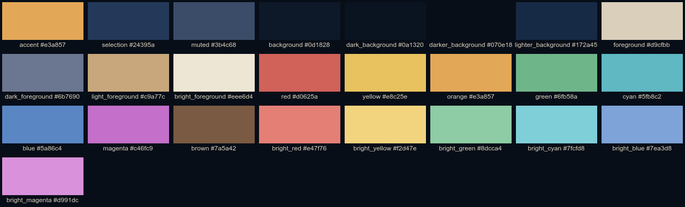
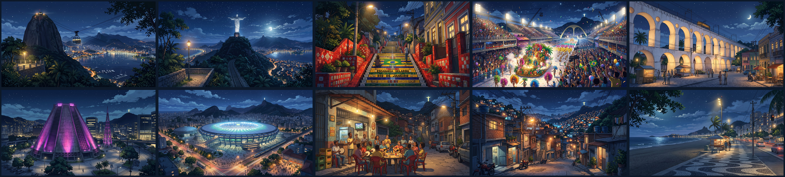

# Omarchy Rio Night Theme

A dark night theme for [Omarchy](https://omarchy.org/) — Rio de Janeiro after
dark, with a deep night-sky navy palette and the warm amber glow of the city's
street lamps as the accent color.

> Tema escuro para o Omarchy inspirado nas noites do Rio de Janeiro: azul do céu
> noturno com o âmbar dos postes como cor de destaque.


## Palette



Colors were picked from the wallpapers:

- **Background** — the navy of the night sky over Guanabara Bay
- **Accent / orange** — street-lamp amber from Lapa and Copacabana
- **Red / yellow / green** — the tiles of the Escadaria Selarón
- **Cyan** — the Maracanã lights
- **Magenta** — the Catedral Metropolitana glow

## Wallpapers



| File | Scene |
|------|-------|
| `rio-night-01-pao-de-acucar.jpg` | Sugarloaf Mountain and the cable car over the bay |
| `rio-night-02-cristo-redentor.jpg` | Christ the Redeemer under the moon |
| `rio-night-03-escadaria-selaron.jpg` | Escadaria Selarón |
| `rio-night-04-sambodromo.jpg` | Carnival parade at the Sambódromo |
| `rio-night-05-arcos-da-lapa.jpg` | Arcos da Lapa and the Santa Teresa tram |
| `rio-night-06-catedral-metropolitana.jpg` | Catedral Metropolitana |
| `rio-night-07-maracana.jpg` | Maracanã stadium |
| `rio-night-08-roda-de-samba.jpg` | Roda de samba at a corner bar |
| `rio-night-09-morro.jpg` | Hillside community streets |
| `rio-night-10-copacabana.jpg` | Copacabana boardwalk |

All wallpapers are 2752×1536 and were AI-generated.

## Installation

Requires an Omarchy installation. Install and apply the theme in one command:

```bash
omarchy theme install https://github.com/thiagoladeira/omarchy-rio-night-theme.git
```

The theme is applied automatically after install. To apply it manually later:

```bash
omarchy theme set rio-night
```

Cycle through the wallpapers with:

```bash
omarchy theme bg next
```

## What gets themed

Omarchy generates every app config from `colors.toml`:

- **Terminals**: Alacritty, Foot, Kitty, Ghostty
- **Neovim, btop, helix, VS Code, tmux**
- **Omarchy shell**: bar, widgets, notifications
- **GTK / Qt** apps, browsers and more

## Customization

Extra backgrounds can go in `~/.config/omarchy/backgrounds/rio-night/` or in
the theme's own `backgrounds/` folder.

## Credits

All wallpapers in `backgrounds/` were AI-generated.

> Todos os wallpapers foram gerados por IA.
